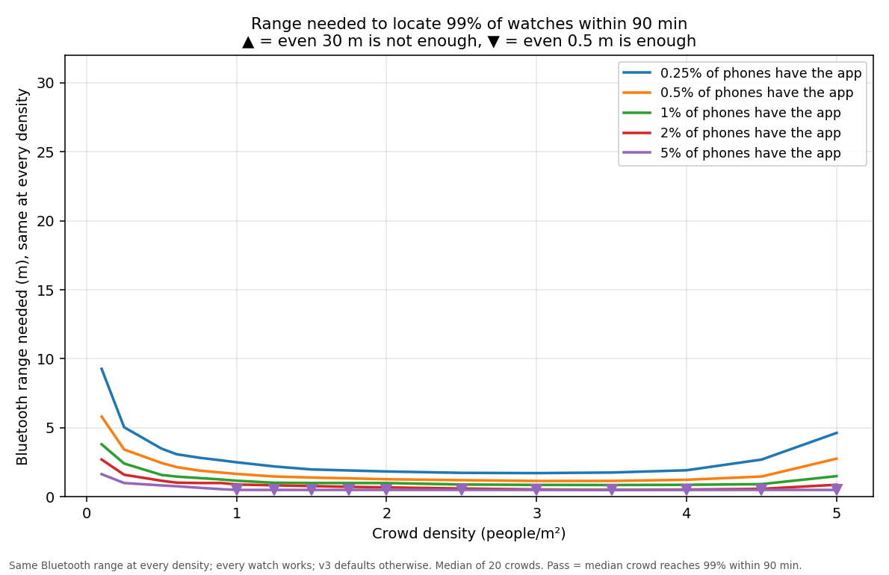
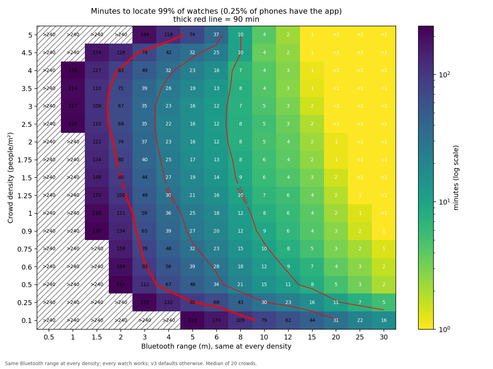
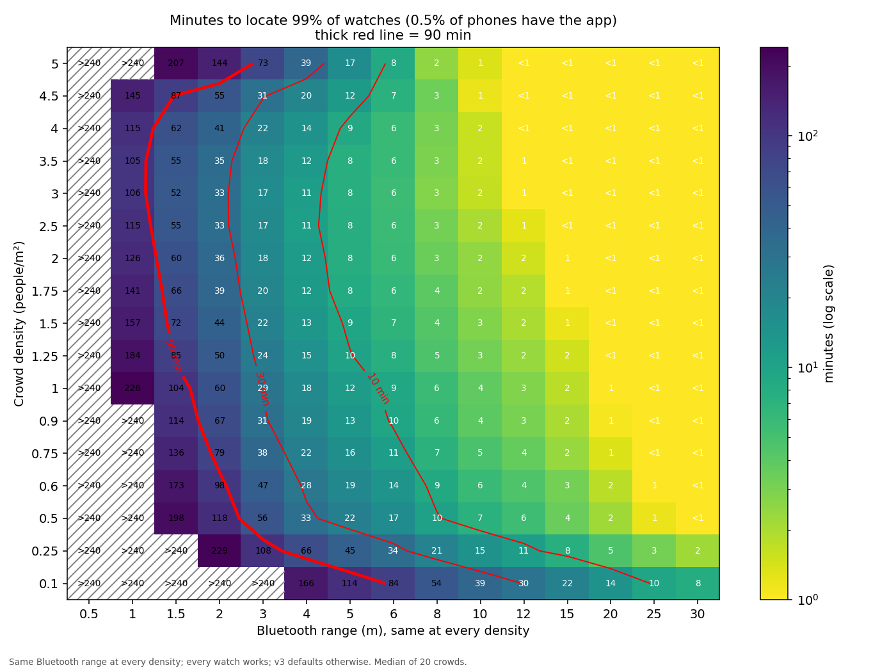
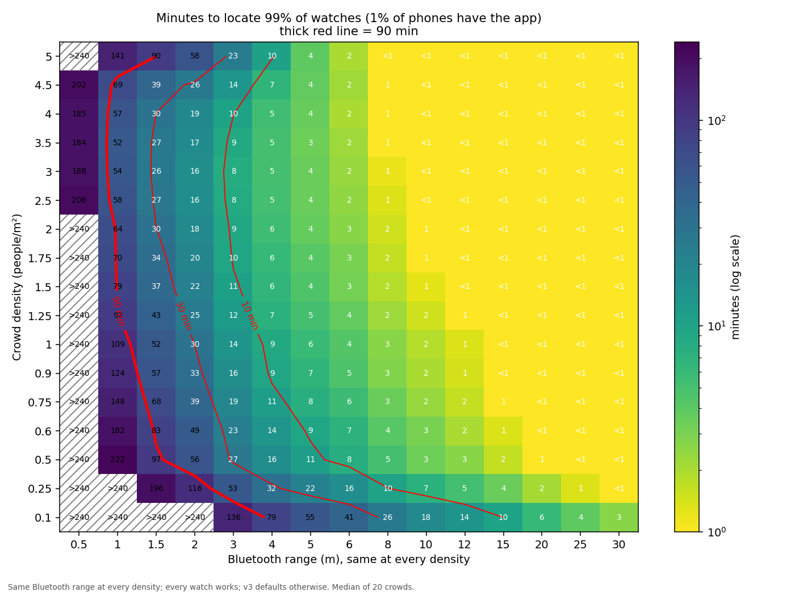
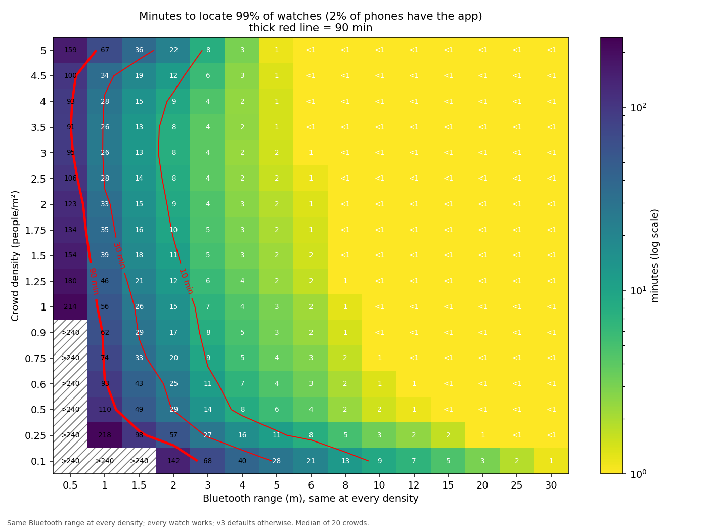
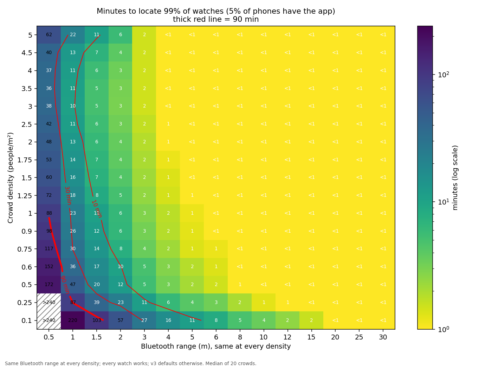

# MILAN: Missing-person Information & Location Alert Network

*"Milan" means "reunion" in Hindi.*

At mass gatherings like the Kumbh Mela, children and elderly people get separated from their families
every day. MILAN turns the crowd's own phones into the search party:

1. Each at-risk **dependent** wears a cheap **ESP32-C3 Bluetooth band** that broadcasts an encrypted,
   rotating ID.
2. Ordinary attendees run the **MILAN guardian app** (Android). It listens quietly in the background,
   and it reports nothing unless a band belongs to someone who is **already marked missing**.
3. When a phone hears a missing dependent, it uploads its GPS position and a summary of the Bluetooth
   signal. An **ML model** turns that signal into a distance, so staff see an accurate "last seen" circle.
4. **Camp staff** watch a live board and map on the **MILAN camp software** (Windows desktop), send
   volunteers to the area, and mark the dependent found at a camp. The guardian's phone then shows
   which camp to go to.

No hardware for the public to buy, no tracking of anyone who isn't missing, and band IDs can't be
followed or forged.

---

## Contents

```
guardian-app/    Flutter Android app for guardians and bystanders (scanner + "Your dependents" + camps)
camp-software/   Electron + React desktop app for camp staff (missing board, map, mark missing/found)
ml-model/        Signal-to-distance model: real field recordings, simulator, training, evaluation
simulations/     Crowd simulator showing the approach works at Kumbh scale, plus parameter sweeps and graphs
supabase/        Postgres schema, row-level security, seed data, SQL tests (shared backend)
firmware/        ESP32-C3 band firmware (Arduino sketch)
docs/            Full build spec, ML method, field-test procedure
releases/        Ready-to-run builds: guardian APK and portable camp .exe
```

---

## Architecture

```
 ESP32-C3 band ──BLE advert: rotating encrypted ID (EID)──▶ any phone running the guardian app
 (on dependent)                                               │  matched locally against the
                                                              │  EIDs of *missing* dependents only
                                                              ▼
                                         Supabase RPC report_sighting(eid, lat, lon, accuracy,
                                                                      median RSSI, adverts heard, IQR)
                                                              ▼
                     Postgres: children · parents · sightings · camps · band_keys (RLS everywhere)
                                                              │  view missing_board (staff only)
                                                              ▼
                     Camp software: board + map. Circle = GPS accuracy + ML-predicted BLE distance (d90)
                                    + nearest camp. Staff mark missing / found-at-camp.
                                                              ▼
                     Guardian app: "Found at <camp>" with directions, until the guardian taps Confirm
```

### Components

| Component | Stack | Key files |
|---|---|---|
| **Band firmware** | ESP32-C3, Arduino, NimBLE-Arduino 2.x | `firmware/beacon/beacon.ino` |
| **Guardian app** | Flutter 3.35, Riverpod, flutter_blue_plus, geolocator, supabase_flutter | `guardian-app/lib/ble/scanner_service.dart` (always-on scanner), `lib/ble/advert_parser.dart`, `lib/data.dart`, `lib/ui/` |
| **Backend** | Supabase (Postgres + Auth + RLS), pgcrypto for AES | `supabase/schema.sql`, `supabase/auth.sql` |
| **Camp software** | Electron, React, TypeScript, react-leaflet + OpenStreetMap | `camp-software/src/main/db.ts`, `src/shared/mlDistanceModel.ts`, `src/renderer/src/` |
| **ML model** | Python, scikit-learn (gradient-boosted quantile regression) | `ml-model/`, exported to `camp-software/src/shared/ml/` |

### How each part works

**Band ID and privacy.** Each band has its own AES-128 key, which only the database holds (no API role
can read `band_keys`). Every 10 minutes the band broadcasts a new 8-byte ID,
`EID = AES-128(key, unix_time / 600)[0..8]`, and changes its BLE address. A bystander therefore can't
track a band or invent a sighting. Phones download only the current EIDs of *missing* dependents
(`get_missing_eids`), and `report_sighting` silently ignores anything that isn't a valid, current EID
of a missing dependent, so IDs can't be probed. The advert is 18 bytes of manufacturer data:
company `0xFFFF`, magic `52 55`, version `02`, then the EID.

**Guardian app.** A single continuous BLE scan runs in a foreground service, and the user can't turn
it off. Every 20 s the app refreshes the missing list. When it hears a match, it uploads at most once
per band per 10 s, and only with a GPS fix under 20 s old. Each upload carries three signal features
computed over the last 10 s of adverts: **median RSSI**, **number of adverts heard** and **RSSI
interquartile range**. Guardians sign in to see their dependents, the nearest camps, and a "Found at
camp" panel with Google Maps directions. The app has no "report missing" button; only camp staff can
mark someone missing.

**Camp software.** Staff sign in with a Supabase account that has `app_metadata.role = 'staff'`. The
app uses only the public anon key; row-level security does the rest, and there is no service-role key
anywhere. The Missing board polls every 3 s. Each sighting is drawn as two concentric circles: the
inner one is GPS accuracy and the outer one is GPS accuracy plus the ML-predicted distance. The board
also shows the nearest camp (haversine) and marks a row stale after 5 minutes. The All dependents tab
marks a dependent missing or found at a chosen camp. The Supabase client lives only in Electron's main
process; the renderer is sandboxed and gets a typed `window.camp` API.

**ML model: signal strength to distance.** Bluetooth signal strength is a poor ruler in a crowd,
because bodies absorb 2.4 GHz. Without a model, the system had to add a fixed 10 m to every circle.
We could not put a real 3-people/m² crowd between a band and a phone at 20 m, so we
**measured each ingredient of signal loss separately and simulated the rest**
(full method: [docs/ml-method.md](docs/ml-method.md)):

1. **Open field**: 36 recorded runs at 1–30 m, with the phone held or in a pocket. These give
   path-loss `A = −44.9 dBm @ 1 m`, `n = 1.61`, and 5.1 dB pocket loss.
2. **Body stacking**: 28 runs at 10 m with 0–9 people standing between band and phone. These give
   the body-loss curve (up to about 42 dB).
3. **Simulator**: 50,000 labelled 10 s windows at random distances (0.5–30 m) and crowd densities
   (0.5–5 people/m²).
4. **Training**: `HistGradientBoostingRegressor` with quantile loss α = 0.9 and monotonic
   constraints. It predicts **d90**, the distance the band is within with 90% confidence.
5. **Testing**: open-field session 3 is real data that no fitting step ever reads.

Results on that real holdout ([ml-model/out/holdout_report.md](ml-model/out/holdout_report.md)):

| Method | Coverage (target 90%) | RMSE | adj. R² | Mean radius |
|---|---|---|---|---|
| Fixed 10 m (before) | 68.6% | 10.38 m | −0.008 | 10.0 m |
| Physics formula only | 98.6% | 315 m | −942 | 119.6 m |
| **ML d90 (shipped)** | **82.9%** | **8.56 m** | **0.283** | 16.0 m |

The 69 exported trees run in TypeScript inside the camp software, with no Python at runtime. A parity
test checks the TypeScript predictions against scikit-learn's.

**Crowd simulation.** [`simulations/kumbh-sim.html`](simulations/kumbh-sim.html) is a self-contained
interactive model of a Kumbh crowd: people, dependents with bands, and the share of phones with the
app installed and actually scanning. It also models GPS availability, upload success and crowd
turnover. Open it in a browser and move the sliders. Every number that is an assumption rather than
a sourced figure is tagged as one, and the defaults are deliberately pessimistic. It shows how
quickly missing bands get located.

[`simulations/sweep/`](simulations/sweep/) is a headless version (`sweep.js`) run over a grid of
Bluetooth ranges (0.5–30 m), densities (0.1–5 people/m²) and install rates (0.25–5% of phones), with
20 seeded crowds per point. The headline graph, `min_range_p99.png`, shows that **at 1% install, a
Bluetooth range of about 1–4 m is enough to locate 99% of bands within 90 minutes at any density**.
Even at 0.25% install, under 10 m is enough. `time_heatmap_*`, `graph1_*` and `graph2_*` show the time
to locate at each range, density and install rate.
*Note: the sweep was run with an earlier version of the simulator's default parameters, which were
less pessimistic than the interactive simulator's current defaults.*

<p align="center"></p>

The time heatmaps show the minutes needed to locate 99% of bands (median of 20 crowds) by Bluetooth
range and crowd density, one per install rate (0.25%, 0.5%, 1%, 2% and 5% of phones). The thick red
line marks 90 minutes:

<p align="center">





</p>

---

## Quick start (prebuilt)

1. Set up the backend (step 1 below). The prebuilt binaries already contain our demo project's URL and
   public anon key. To use your own project, build from source.
2. **Camp software:** run `releases/milan-camp-1.0.0-portable.exe` on Windows. Nothing needs
   installing. It is unsigned, so if SmartScreen warns, choose More info → Run anyway.
3. **Guardian app:** sideload `releases/milan-guardian-1.0.0.apk` on an Android 8+ phone. Bluetooth
   needs a real phone, because emulators have no Bluetooth.

## Setup from source

**Prerequisites:** a free [Supabase](https://supabase.com) project, Flutter 3.35+ with the Android SDK,
Node.js 22+, and Python 3.13+ (only to retrain the model). Building band firmware also needs the
Arduino IDE.

### 1. Backend (Supabase)

1. In the Supabase SQL editor, run `supabase/schema.sql` (**once**, on an empty project), then
   `auth.sql`, then `seed.sql` (once).
2. Under Authentication → Users → Add user, create these users and tick **Auto Confirm**:
   `parent1@demo.test`, `parent2@demo.test`, `parent3@demo.test`, `staff@demo.test`.
3. Re-run `auth.sql` so `staff@demo.test` gets the staff role. Then run `tests.sql`, which should
   print `All tests passed`.
4. Optional: check the API surface. Copy `supabase/.env.example` to `supabase/.env`, fill it in, then
   run `set -a; . supabase/.env; set +a; sh supabase/anon-check.sh`.

(`supabase/migrations/` upgrades a project that was created with an older schema. A fresh project
doesn't need it.)

### 2. Camp software

```
cd camp-software
cp .env.example .env          # set SUPABASE_URL and SUPABASE_ANON_KEY (Project Settings → API)
npm install
npm run dev                   # sign in as staff@demo.test
```

To build the portable Windows .exe, run `npm run build:win-portable`. The output goes to `dist/`.

### 3. Guardian app

```
cd guardian-app
cp dart-defines.example.json dart-defines.json   # set SUPABASE_URL and SUPABASE_ANON_KEY
flutter pub get
flutter run --dart-define-from-file=dart-defines.json
```

To build a release APK, run `flutter build apk --release --dart-define-from-file=dart-defines.json`.
Release builds leave out the debug and field-test screens. In debug builds you reach them by
long-pressing the title.

### 4. Band firmware (optional: the demo works without a band, see below)

1. In the Arduino IDE, install the **esp32** board package and the **NimBLE-Arduino 2.x** library.
2. Open `firmware/beacon/beacon.ino`. Set the board to **ESP32C3 Dev Module** with
   **USB CDC On Boot: Enabled**, then upload.
3. Open the Serial Monitor at 115200 baud, with Newline line endings. Run
   `supabase/provision-band.sql` in the SQL editor; it prints `ID`, `KEY` and `TIME` lines for each
   dependent. Paste `ID` and `KEY`, re-run the query, then paste `TIME`. Treat the key as a secret.
4. `INFO` prints the band's current EID. Crypto self-check: send
   `KEY 000102030405060708090a0b0c0d0e0f`, `ID 1`, `TIME 1771407000`. `INFO` must show
   `eid=4f60ca774199673f`.

### 5. ML model (optional: the trained model already ships in the camp software)

See [ml-model/README.md](ml-model/README.md). In short:
`pip install -r requirements.txt`, then run `build_dataset.py`, `train.py`, `evaluate_holdout.py` and
`export_model.py`, and copy the two exported JSON files into `camp-software/src/shared/ml/`.

---

## Demo walkthrough (no band or phone needed)

```
cd camp-software
npm run demo            # opens the camp software and fakes a phone sighting every 4 s
```

1. Sign in as `staff@demo.test`.
2. Go to **All dependents** and mark a dependent **missing**. Phones report sightings only for missing
   dependents.
3. Open the **Missing board**. Within seconds a last-seen circle appears, along with the nearest camp
   and a "GPS ±x m + BLE y m" breakdown. Each new sighting flashes its row.
4. Mark the dependent **found** at a camp. On a phone signed in as `parent1@demo.test`, the guardian
   app shows "Found at <camp>" with directions.

`npm run fake-sighting` sends one sighting. It uses the same anon RPCs as a real phone, with realistic
signal values.

### Sample data (`supabase/seed.sql`)

- 4 help camps on the Ashoka University campus.
- 3 parents, `parent1@demo.test` to `parent3@demo.test`, with dummy Aadhaar numbers only (a check
  constraint rejects real-looking ones).
- 4 dependents wearing bands `KM-000001` to `KM-000004`.

Real signal recordings are in `ml-model/rssi/`, and the simulated training data is in
`ml-model/out/*/dataset.csv`.

---

## Tests

| Where | Command | What it covers |
|---|---|---|
| `supabase/tests.sql` | run in the SQL editor | AES known-answer vectors (shared with firmware and app), EID rotation, anon / parent / staff access rules, Aadhaar column hidden from every role, sightings rejected for non-missing or invalid EIDs, found-at-camp / acknowledge flow |
| `supabase/anon-check.sh` | `sh supabase/anon-check.sh` | What the public anon key can and can't do over the real REST API |
| `guardian-app/test/` | `flutter test` | 30 tests: advert parsing, upload throttle, haversine, signal-window statistics, field-test CSV and run-sheet logic |
| `camp-software/src/shared/*.test.ts` | `npm test` | 10 tests: formatting, stale rows, and **ML parity**: the TypeScript tree walker must match scikit-learn on every case in `test_suite.json` |
| `ml-model/evaluate_holdout.py` | `python evaluate_holdout.py` | Model accuracy on held-out real recordings |

CI (`.github/workflows/ci.yml`) runs format, analyze and tests for the guardian app, and typecheck,
lint and tests for the camp software.

---

## Documentation

- [docs/SPEC.md](docs/SPEC.md): full build spec. Data model, RPCs, access model, advert format,
  screens, end-to-end acceptance tests, and the shortcuts taken for the demo.
- [docs/ml-method.md](docs/ml-method.md): how the signal-to-distance dataset and model were built
  without a real crowd.
- [docs/field-test-guide.md](docs/field-test-guide.md): the procedure used to record the field data.

## Known limitations (demo scope)

Android only. Status is polled rather than streamed in real time. Distances are straight-line. There
is no offline upload queue. The model was calibrated on a single phone model (Pixel 8). A recorded
advert can be replayed for up to 30 minutes. Band keys are stored unencrypted in the ESP32's flash.
See [docs/SPEC.md §7–8](docs/SPEC.md#7-demo-shortcuts-known-and-accepted).

## Security note

No secrets are committed: `.env` and `dart-defines.json` are gitignored, and only the `*.example`
files are included. The prebuilt binaries contain our demo project's URL and **anon** key. Both are
public by design, and all access control is enforced by row-level security.

## License

[MIT](LICENSE) © 2026 Abhinnav Abbu & Aaryan Bahri
